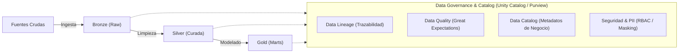
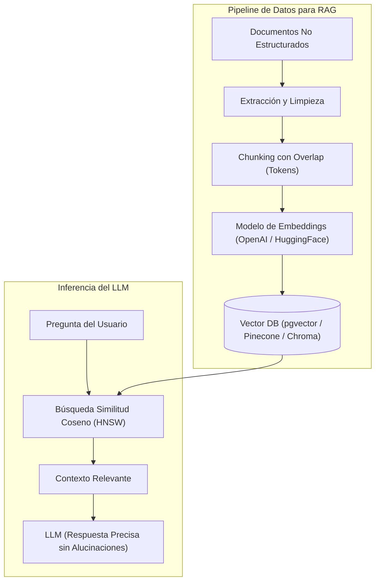

# Guía Maestra de Entrevista Técnica: Data Engineer (iCube Technologies)
## Especialización en SQL Performance Tuning, Arquitectura Cloud y Gobernanza

Esta guía es tu **manual táctico de combate** para la entrevista técnica con iCube. Incorpora todos los conceptos avanzados de **SQL Performance Tuning e Internals del Optimizador** que entrenaste en tu laboratorio de maestría (`mastery-lab`), estructurados bajo la metodología de **pregunta real del Tech Lead -> respuesta modelo senior -> trampa del entrevistador -> código y arquitectura de respaldo**.

---

## Índice Temático
1. [Bloque 1: SQL Performance Tuning & Internals del Motor (Mastery Lab Core)](#bloque-1-sql-performance-tuning--internals-del-motor)
   * 1.1 [Diagnóstico de Planes de Ejecución: Table Scan vs. Index Seek](#11-diagnóstico-de-planes-de-ejecución-table-scan-vs-index-seek)
   * 1.2 [Key Lookups y la Solución con Índices Cubrientes (`INCLUDE`)](#12-key-lookups-y-la-solución-con-índices-cubrientes-include)
   * 1.3 [Índices Filtrados (Partial Indexes) para Tablas Masivas](#13-índices-filtrados-partial-indexes-para-tablas-masivas)
   * 1.4 [SARGability: Por qué las Consultas Inocentes Matan el Rendimiento](#14-sargability-por-qué-las-consultas-inocentes-matan-el-rendimiento)
   * 1.5 [El Dilema del Top-N por Grupo: `CROSS APPLY` vs. `ROW_NUMBER()`](#15-el-dilema-del-top-n-por-grupo-cross-apply-vs-row_number)
   * 1.6 [Los 3 Algoritmos Físicos de JOIN y el Peligro Mortal del Hash Spill a TempDB](#16-los-3-algoritmos-físicos-de-join-y-el-peligro-mortal-del-hash-spill-a-tempdb)
   * 1.7 [Tuning de Funciones de Ventana: El Secreto del Marco Físico (`ROWS` vs `RANGE`)](#17-tuning-de-funciones-de-ventana-el-secreto-del-marco-físico-rows-vs-range)
   * 1.8 [La Trampa Clásica de `LAST_VALUE()` y su Solución](#18-la-trampa-clásica-de-last_value-y-su-solución)
   * 1.9 [UPSERT Atómico con `MERGE INTO` vs. El Antipatrón del Doble Pase](#19-upsert-atómico-con-merge-into-vs-el-antipatrón-del-doble-pase)
2. [Bloque 2: Python para Ingeniería de Datos y Pipelines](#bloque-2-python-para-ingeniería-de-datos-y-pipelines)
3. [Bloque 3: Catálogo de Datos y Gobernanza de Datos](#bloque-3-catálogo-de-datos-y-gobernanza-de-datos)
4. [Bloque 4: Dominio Multi-Cloud (AWS, Azure, GCP y Databricks)](#bloque-4-dominio-multi-cloud-aws-azure-gcp-y-databricks)
5. [Bloque 5: Modelado Dimensional: Copo de Nieve vs. Estrella](#bloque-5-modelado-dimensional-copo-de-nieve-vs-estrella)
6. [Bloque 6: LLMs y GenAI en la Ingeniería de Datos (Pipelines RAG)](#bloque-6-llms-y-genai-en-la-ingeniería-de-datos)
7. [Bloque 7: Resolución de Incidentes Críticos en Producción](#bloque-7-resolución-de-incidentes-críticos-en-producción)

---

## Bloque 1: SQL Performance Tuning & Internals del Motor

### Concepto de Entrada: La Mentalidad Senior
* **Nivel Junior:** Escribe consultas que devuelven el resultado esperado sin considerar el consumo de recursos ($O(N)$ scans, memoria desbordada y CPU al 100%).
* **Nivel Senior:** Logra el mismo resultado reduciendo el I/O en disco y el uso de RAM entre **10 y 100 veces**, logrando respuestas en milisegundos mediante el entendimiento del Optimizador Basado en Costos (CBO).

---

### 1.1 Diagnóstico de Planes de Ejecución: Table Scan vs. Index Seek

#### Pregunta del Entrevistador:
> *"Cuando una consulta en producción comienza a degradarse, ¿cómo utilizas el Plan de Ejecución para identificar el cuello de botella?"*

#### Respuesta Modelo Senior:
> *"Lo primero que inspecciono en el Execution Plan (`EXPLAIN QUERY PLAN` en DBeaver o el plan gráfico en SSMS) es el tipo de operador de acceso a datos:*
> * **`Table Scan` / `Clustered Index Scan`:** El motor está obligado a leer secuencialmente todas las páginas de la tabla en disco ($O(N)$). Si la tabla tiene 50 millones de filas, esto satura el ancho de banda del almacenamiento.
> * **`Index Seek`:** El motor navega la estructura de árbol balanceado (**B-Tree**) del índice. En apenas 3 o 4 saltos de punteros en memoria ubica exactamente los registros requeridos ($O(\log N)$).
> * Además, reviso los operadores más costosos: **Sorts innecesarios**, **Key Lookups** y operadores con discrepancias severas entre el *Estimated Number of Rows* y el *Actual Number of Rows*, lo cual evidencia estadísticas desactualizadas."*

```
┌────────────────────────────────────────────────────────────────────────────────────────┐
│  BENCHMARK REAL (Mastery Lab - 120,000 Filas FactSales)                                │
├────────────────────────────────┬───────────────────────────────────────────────────────┤
│ SIN ÍNDICE (Table Scan):       │ detail: SCAN FactSales                                │
│ Costo: Alto I/O ($O(N)$)       │ Lee 120,000 filas de forma secuencial en disco        │
├────────────────────────────────┼───────────────────────────────────────────────────────┤
│ CON ÍNDICE COMPUESTO:          │ detail: SEARCH FactSales USING INDEX IX_Cust_Date     │
│ Costo: Milisegundos ($O(\log N)$) Salto binario directo a las hojas del árbol B-Tree   │
└────────────────────────────────┴───────────────────────────────────────────────────────┘
```

---

### 1.2 Key Lookups y la Solución con Índices Cubrientes (`INCLUDE`)

#### Pregunta del Entrevistador:
> *"En el plan de ejecución vemos un Index Seek, pero la consulta sigue siendo lenta y el operador 'Key Lookup' (o Bookmark Lookup) consume el 85% del costo. ¿Por qué ocurre y cómo lo erradicas?"*

#### Respuesta Modelo Senior:
> *"El Key Lookup ocurre cuando el motor utiliza un índice secundario no agrupado (*Nonclustered Index*) para resolver el filtro del `WHERE`, pero la consulta solicita columnas adicionales en el `SELECT` que **no están contenidas en ese índice**. Por cada fila encontrada en el índice, el motor debe saltar a la tabla principal (el *Clustered Index*) a recuperar las columnas faltantes. Si la consulta devuelve 50,000 filas, son 50,000 lecturas aleatorias adicionales en disco.*
> *La solución de ingeniería es crear un **Índice Cubriente (Covering Index)** utilizando la cláusula **`INCLUDE`**:*
> * Las columnas de filtro van en la clave del índice (`ON FactSales(CustomerID, SaleDate)`).
> * Las columnas de salida van en el `INCLUDE` (`INCLUDE (Amount, Status)`).*
> 
> *¿Por qué `INCLUDE` y no ponerlas en la clave principal? Porque las columnas en `INCLUDE` residen **únicamente en el nivel hoja** del B-Tree. No ensanchan las ramas intermedias del árbol, no consumen RAM innecesaria y no penalizan el rendimiento de los `INSERT` y `UPDATE`."*

#### Código de Respaldo:
```sql
-- Índice cubriente que elimina el Key Lookup al 100%
CREATE NONCLUSTERED INDEX IX_FactSales_Customer_Date_Covering
ON FactSales (CustomerID, SaleDate)
INCLUDE (Amount, Status);

-- Ahora esta consulta se resuelve completamente en memoria desde el índice secundario:
SELECT CustomerID, SaleDate, Amount, Status 
FROM FactSales 
WHERE CustomerID = 4500 AND SaleDate >= '2026-01-01';
```

---

### 1.3 Índices Filtrados (Partial Indexes) para Tablas Masivas

#### Pregunta del Entrevistador:
> *"Tenemos una tabla con 100 millones de transacciones donde el 95% son transacciones finalizadas ('COMPLETED') y solo el 5% son pendientes ('PENDING'). Las consultas operativas solo consultan las pendientes. ¿Indexas toda la tabla?"*

#### Respuesta Modelo Senior:
> *"No, indexar toda la tabla sería un desperdicio masivo de recursos. Creo un **Índice Filtrado (Filtered Index / Partial Index)** con un predicado `WHERE`:*
> ```sql
> CREATE NONCLUSTERED INDEX IX_FactSales_Pending
> ON FactSales (SaleDate, CustomerID)
> INCLUDE (Amount)
> WHERE Status = 'PENDING';
> ```
> * **Ahorro de espacio:** El índice ocupa un 95% menos de espacio en disco y memoria RAM.
> * **Cero penalización en escritura:** Cuando el sistema inserte millones de transacciones completadas, el motor **no toca este índice**, evitando la fragmentación y degradación del rendimiento transaccional."*

---

### 1.4 SARGability: Por qué las Consultas Inocentes Matan el Rendimiento

#### Pregunta del Entrevistador:
> *"¿Qué significa que una consulta sea 'SARGable' (Search Argument Able) y cuál es el error más común que cometen los desarrolladores?"*

#### Respuesta Modelo Senior:
> *"Una consulta es **SARGable** cuando está redactada de forma que el optimizador del motor puede aprovechar directamente un índice mediante un **Index Seek**. El error más común es **envolver la columna indexada dentro de una función o cálculo matemático en la cláusula `WHERE`**.*
> *Al aplicar una función a la columna, el motor pierde la capacidad de buscar en el árbol B-Tree y se ve forzado a ejecutar la función fila por fila en toda la tabla, degenerando en un **Table Scan completo**."*

#### Ejemplos Clásicos de Transformación SARGable:

| Antipatrón NO SARGable (Scan Obligatorio) | Patrón SARGable Optimizado (Index Seek Inmediato) |
| :--- | :--- |
| `WHERE YEAR(SaleDate) = 2026` | `WHERE SaleDate >= '2026-01-01' AND SaleDate < '2027-01-01'` |
| `WHERE UPPER(CustomerCode) = 'ABC'` | Almacenar en mayúsculas o usar collation case-insensitive |
| `WHERE Amount + 50 > 1000` | `WHERE Amount > 950` (Despejar la variable) |
| `WHERE CustomerName LIKE '%Tech'` | `WHERE CustomerName LIKE 'Tech%'` (El comodín inicial destruye el Seek) |
| `WHERE CAST(Phone AS VARCHAR) = '123'` | Usar tipos de datos idénticos para evitar conversiones implícitas |

---

### 1.5 El Dilema del Top-N por Grupo: `CROSS APPLY` vs. `ROW_NUMBER()`

#### Pregunta del Entrevistador:
> *"De una tabla con 50 millones de ventas, necesitas obtener las 2 mayores compras de cada uno de nuestros 5,000 clientes. ¿Por qué `CROSS APPLY` suele ser órdenes de magnitud más rápido que un CTE con `ROW_NUMBER() <= 2`?"*

#### Respuesta Modelo Senior:
> *"Es una cuestión de cómo opera el optimizador en memoria:*
> * **El costo de `ROW_NUMBER()`:** En un CTE con `ROW_NUMBER() OVER(PARTITION BY CustomerID ORDER BY Amount DESC)`, el motor tiene que cargar, particionar y ordenar en memoria (**operador Sort**) **las 50 millones de filas completas**, para luego descartar el 95% al aplicar el filtro `WHERE row_num <= 2`.
> * **La ventaja de `CROSS APPLY`:** En T-SQL, `CROSS APPLY` ejecuta una subconsulta correlacionada lateral por cada cliente. Si existe un índice compuesto en `FactSales(CustomerID, Amount DESC)`, el motor realiza un **Index Seek** por cliente, lee únicamente los **2 primeros registros** del árbol B-Tree y **se detiene al instante**.
> * **Cálculo de I/O:** Para 5,000 clientes, `CROSS APPLY` realiza exactamente $5,000 \times 2 = 10,000$ lecturas indexadas ultra-rápidas, convirtiendo una consulta de 5 minutos que saturaría TempDB en una ejecución de milisegundos."*

#### Código Comparativo:
```sql
-- Solución de Alto Rendimiento con CROSS APPLY:
SELECT 
    c.CustomerID,
    c.CustomerName,
    top_orders.SaleID,
    top_orders.SaleDate,
    top_orders.Amount
FROM DimCustomer c
CROSS APPLY (
    SELECT TOP (2) s.SaleID, s.SaleDate, s.Amount
    FROM FactSales s
    WHERE s.CustomerID = c.CustomerID
    ORDER BY s.Amount DESC
) AS top_orders
ORDER BY c.CustomerID, top_orders.Amount DESC;
```

---

### 1.6 Los 3 Algoritmos Físicos de JOIN y el Peligro Mortal del Hash Spill a TempDB

#### Pregunta del Entrevistador:
> *"Explica los 3 algoritmos físicos de JOIN que utiliza un motor relacional. ¿Cuándo se utiliza cada uno y qué es un 'Spill to TempDB'?"*

#### Respuesta Modelo Senior:
> *"A nivel lógico todos escribimos `JOIN`, pero el motor ejecuta uno de tres algoritmos físicos:*
> 1. **Nested Loops Join:** Funciona como dos bucles anidados en código. Es óptimo cuando la tabla exterior es pequeña y la tabla interior tiene un índice en la clave de unión ($O(M \cdot \log N)$).
> 2. **Merge Join:** Funciona como el algoritmo de Merge Sort (efecto cremallera). Dos punteros avanzan secuencialmente. Es el más rápido y eficiente ($O(M + N)$), pero **requiere obligatoriamente que ambas tablas estén pre-ordenadas** por la clave de unión (ej. mediante índices clustered).
> 3. **Hash Match Join:** Se utiliza en Data Warehousing para tablas masivas sin índices. Opera en dos fases:
>    * *Fase de Construcción (Build):* Construye una tabla hash en memoria RAM con la tabla más pequeña.
>    * *Fase de Sondeo (Probe):* Escanea la tabla grande y busca coincidencias en el hash.
>
> **El Peligro Crítico: Hash Spill / Sort Spill a TempDB:**  
> Ocurre cuando las estadísticas están desactualizadas (*Stale Statistics*). El optimizador subestima la cantidad de filas y le asigna a la consulta una concesión de memoria RAM (*Memory Grant*) insuficiente (ejemplo: 10 MB cuando se requerían 200 MB). Al agotarse la RAM, el motor se desborda y comienza a escribir y leer páginas en el disco temporal (**TempDB** en SQL Server o disco local en Postgres/Spark).  
> **Impacto:** Una consulta que debería tardar 2 segundos pasa a tardar 20 minutos por saturación de I/O de disco. Se soluciona actualizando estadísticas con `UPDATE STATISTICS tabla WITH FULLSCAN` o creando el índice adecuado para evitar el Sort/Hash."*

---

### 1.7 Tuning de Funciones de Ventana: El Secreto del Marco Físico (`ROWS` vs `RANGE`)

#### Pregunta del Entrevistador:
> *"Al calcular un total acumulado (Running Total) con `SUM(Amount) OVER (PARTITION BY ... ORDER BY ...)`, ¿por qué omitir la definición del marco de ventana puede degradar gravemente el rendimiento?"*

#### Respuesta Modelo Senior:
> *"Porque por estándar ANSI SQL, si defines un `ORDER BY` sin especificar el marco físico, el motor inyecta automáticamente por defecto:*
> `RANGE BETWEEN UNBOUNDED PRECEDING AND CURRENT ROW`
> * **El problema de `RANGE`:** Obliga al motor a comprobar si existen valores duplicados en la columna de ordenamiento para agruparlos en memoria, creando un archivo spool temporal en TempDB.
> * **La solución con `ROWS`:** Al escribir explícitamente `ROWS BETWEEN UNBOUNDED PRECEDING AND CURRENT ROW`, le indicamos al motor que sume de forma física y secuencial fila por fila directamente en memoria. En pruebas de volumen, **`ROWS` es entre 5 y 10 veces más rápido que `RANGE`**."*

#### Código Optimizado:
```sql
SELECT 
    CustomerID,
    SaleDate,
    Amount,
    -- Tuning obligatorio: 'ROWS' en vez de 'RANGE' por defecto
    ROUND(SUM(Amount) OVER (
        PARTITION BY CustomerID 
        ORDER BY SaleDate
        ROWS BETWEEN UNBOUNDED PRECEDING AND CURRENT ROW
    ), 2) AS running_total
FROM FactSales;
```

---

### 1.8 La Trampa Clásica de `LAST_VALUE()` y su Solución

#### Pregunta del Entrevistador:
> *"¿Por qué `LAST_VALUE(Amount) OVER (PARTITION BY CustomerID ORDER BY SaleDate)` devuelve el monto de la fila actual en lugar del último monto histórico del cliente?"*

#### Respuesta Modelo Senior:
> *"Es la trampa más común de las funciones de ventana. Debido a que el marco por defecto es `RANGE BETWEEN UNBOUNDED PRECEDING AND CURRENT ROW`, la ventana de cálculo **termina físicamente en la fila donde está parado el motor (`CURRENT ROW`)**. Por lo tanto, para el motor, el 'último valor' visible en ese instante es la fila actual.  
> Para que devuelva la última compra histórica real de la partición, debemos expandir explícitamente el marco de principio a fin:*
> `ROWS BETWEEN UNBOUNDED PRECEDING AND UNBOUNDED FOLLOWING`."*

```sql
SELECT 
    CustomerID,
    SaleDate,
    Amount,
    FIRST_VALUE(Amount) OVER (
        PARTITION BY CustomerID ORDER BY SaleDate, SaleID
        ROWS BETWEEN UNBOUNDED PRECEDING AND UNBOUNDED FOLLOWING
    ) AS primera_compra_historica,
    LAST_VALUE(Amount) OVER (
        PARTITION BY CustomerID ORDER BY SaleDate, SaleID
        ROWS BETWEEN UNBOUNDED PRECEDING AND UNBOUNDED FOLLOWING
    ) AS ultima_compra_historica
FROM FactSales;
```

---

### 1.9 UPSERT Atómico con `MERGE INTO` vs. El Antipatrón del Doble Pase

#### Pregunta del Entrevistador:
> *"En un pipeline ETL diario, recibes registros nuevos y registros modificados. ¿Por qué nunca deberías ejecutar un `UPDATE` manual seguido de un `INSERT` en producción?"*

#### Respuesta Modelo Senior:
> *"El doble pase (`UPDATE` manual y luego `INSERT WHERE NOT EXISTS`) es un antipatrón peligroso por tres razones:*
> 1. **Doble Lectura de Disco:** Obliga al motor a escanear dos veces la tabla destino, duplicando el consumo de I/O de disco.
> 2. **Condiciones de Carrera (Race Conditions):** Si otro proceso o pipeline escribe entre el UPDATE y el INSERT, se provocan duplicados o violaciones de clave primaria.
> 3. **Bloqueos (Deadlocks):** Adquiere dos bloqueos de escritura separados sobre la tabla, congelando consultas concurrentes.
> 
> *La solución de ingeniería es una operación **atómica en un solo pase de disco**:*
> * En **T-SQL, Snowflake y Databricks Delta Lake:** Sentencia **`MERGE INTO ... USING ... ON MATCHED / NOT MATCHED`**.
> * En **PostgreSQL y SQLite:** Sentencia **`INSERT INTO ... ON CONFLICT (...) DO UPDATE`**."*

#### Código de Respaldo:
```sql
MERGE INTO dbo.FactSales AS target
USING dbo.StagingSales AS source
ON target.SaleID = source.SaleID

WHEN MATCHED AND (target.Amount <> source.Amount OR target.Status <> source.Status) THEN
    UPDATE SET 
        target.Amount   = source.Amount,
        target.Status   = source.Status,
        target.SaleDate = source.SaleDate

WHEN NOT MATCHED BY TARGET THEN
    INSERT (SaleID, CustomerID, SaleDate, Category, Amount, Status)
    VALUES (source.SaleID, source.CustomerID, source.SaleDate, source.Category, source.Amount, source.Status);
```

---

## Bloque 2: Python para Ingeniería de Datos y Pipelines

### Pregunta 2.1: *"¿Cómo procesas un archivo CSV de 50 GB en un servidor con solo 8 GB de RAM sin fallar por Out Of Memory (OOM)?"*

#### Respuesta Modelo Senior:
> *"Aplico una de tres estrategias según el entorno:*
> 1. **Chunking con Pandas (`chunksize`):** Proceso fragmentos de 50,000 o 100,000 filas a la vez en memoria, liberando cada bloque con el recolector de basura antes de cargar el siguiente.
> 2. **Generadores nativos de Python (`yield`):** Mantienen una sola línea o registro en memoria ($O(1)$ de RAM).
> 3. **Motores de ejecución fuera de memoria (PyArrow / Polars):** Uso `polars.scan_csv()` o datasets en streaming de `pyarrow`. Estos motores no cargan el archivo entero en memoria: compilan un plan de ejecución lazy y aplican pushdown de predicados y proyecciones para leer únicamente las columnas y filas necesarias."*

#### Código de Respaldo:
```python
import pandas as pd

def process_large_dataset(filepath: str, chunk_size: int = 50000):
    total_sales = 0.0
    for chunk in pd.read_csv(filepath, chunksize=chunk_size):
        clean = chunk[chunk["status"] == "COMPLETED"]
        total_sales += clean["amount"].sum()
    return total_sales
```

---

## Bloque 3: Catálogo de Datos y Gobernanza de Datos



### Pregunta 3.1: *"¿Qué es un Catálogo de Datos y cuál es tu experiencia con Gobernanza?"*

#### Respuesta Modelo Senior:
> *"Un Catálogo de Datos es el inventario centralizado de metadatos técnicos y de negocio de toda la organización. Resuelve tres necesidades fundamentales:*
> 1. **Descubrimiento del dato:** Centraliza la búsqueda de tablas, esquemas, columnas y dashboards.
> 2. **Linaje del dato (Data Lineage):** Permite ver el grafo de dependencias de punta a punta. Si modifico una tabla en la capa Bronze o Silver, sé exactamente qué pipelines downstream y qué reportes de BI se verían afectados.
> 3. **Seguridad y Cumplimiento (PII):** Clasifico columnas sensibles (emails, números de tarjeta, teléfonos) y aplico control de accesos basado en roles (**RBAC**) y enmascaramiento dinámico a nivel de columna.
> *En mis proyectos he trabajado con **Databricks Unity Catalog** (y su equivalente en AWS Glue Catalog / Azure Purview), integrando validaciones automáticas de calidad con **Great Expectations** para frenar datos corruptos antes de la capa Gold."*

---

## Bloque 4: Dominio Multi-Cloud (AWS, Azure, GCP y Databricks)

### La Técnica del "Puente Conceptual"
Cuando te pregunten por un servicio de una nube que no hayas usado todos los días, responde demostrando dominio de los **patrones de arquitectura**:

> *"Las arquitecturas modernas de datos siguen patrones universales en cualquier proveedor: un almacenamiento de objetos escalable (Data Lake), un motor de procesamiento distribuido (Spark), un Data Warehouse columnar y un orquestador."*

### Tabla Comparativa Maestra:

| Capa Arquitectónica | AWS | Azure | Google Cloud (GCP) | Databricks / Open Source |
| :--- | :--- | :--- | :--- | :--- |
| **Data Lake (Storage)** | **Amazon S3** | **ADLS Gen2** | **Cloud Storage (GCS)** | Formato **Delta Lake** sobre storage |
| **Motor Spark Distribuido** | **AWS EMR / AWS Glue** | **Azure Databricks / Synapse** | **Dataproc** | **Databricks Runtime (Spark)** |
| **Data Warehouse (OLAP)** | **Amazon Redshift** | **Azure Synapse / Fabric** | **BigQuery** | **Databricks SQL Warehouse** |
| **Pipeline Serverless / ETL**| **AWS Glue** | **Azure Data Factory (ADF)** | **Dataflow (Apache Beam)** | **Delta Live Tables (DLT)** |
| **Orquestación de Flujos** | **AWS MWAA (Airflow)** | **Data Factory Pipelines** | **Cloud Composer (Airflow)** | **Databricks Workflows / Airflow**|
| **Gobernanza y Catálogo** | **AWS Glue Data Catalog** | **Microsoft Purview** | **Dataplex** | **Unity Catalog** |
| **Mensajería / Streaming** | **Amazon Kinesis / MSK** | **Event Hubs** | **Pub/Sub** | **Apache Kafka / Spark Streaming**|

---

## Bloque 5: Modelado Dimensional: Copo de Nieve vs. Estrella

```mermaid
classDiagram
    class Fact_Ventas {
        +int venta_id
        +int cliente_id
        +int producto_id
        +decimal monto
    }
    class Dim_Producto_Estrella {
        +int producto_id
        +string nombre
        +string subcategoria
        +string categoria
    }
    Fact_Ventas --> Dim_Producto_Estrella : "Estrella: Dimensión Desnormalizada (1 sola tabla)"

    class Dim_Producto_Copo {
        +int producto_id
        +string nombre
        +int subcategoria_id
    }
    class Dim_Subcategoria {
        +int subcategoria_id
        +string nombre_subcategoria
        +int categoria_id
    }
    class Dim_Categoria {
        +int categoria_id
        +string nombre_categoria
    }
    Dim_Producto_Copo --> Dim_Subcategoria : "Copo de Nieve: Normalizado en 3NF"
    Dim_Subcategoria --> Dim_Categoria
```

### Pregunta 5.1: *"¿Cuál es la diferencia entre el Modelo Copo de Nieve y el Modelo Estrella, y cuál prefieres en Big Data moderno?"*

#### Respuesta Modelo Senior:
> *"La diferencia radica en el **grado de normalización de las tablas de dimensiones**:*
> * **Modelo Estrella (Star Schema):** Dimensiones desnormalizadas (planas). Alrededor de la tabla de Hechos, cada dimensión está en una sola tabla (ejemplo: `Dim_Producto` contiene categoría y subcategoría). Consultas simples, pocos `JOINs`, óptimo para BI.
> * **Modelo Copo de Nieve (Snowflake Schema):** Dimensiones normalizadas en tercera forma normal (3NF), dividiéndose en sub-tablas jerárquicas (`Producto` ➔ `Subcategoria` ➔ `Categoria`). Ahorra espacio pero multiplica los `JOINs`.
>
> **¿Cuál prefiero en Big Data moderno?**  
> *"En motores analíticos columnares modernos (Databricks Delta Lake, Snowflake, BigQuery) **prefiero decididamente el Modelo Estrella o tablas desnormalizadas**. El costo de almacenamiento en disco hoy es insignificante comparado con el costo computacional de red y memoria. En sistemas distribuidos, cada `JOIN` adicional provoca un **Shuffle masivo de datos por la red entre nodos**, degradando fuertemente el rendimiento. Por eso, desnormalizar para acelerar lecturas es el estándar de oro."*

---

## Bloque 6: LLMs y GenAI en la Ingeniería de Datos



### Pregunta 6.1: *"¿Cuál es el rol de un Data Engineer en proyectos con LLMs y qué es un pipeline RAG?"*

#### Respuesta Modelo Senior:
> *"El Data Engineer construye la 'fontanería de datos' para que los LLMs respondan con datos corporativos reales sin alucinar, mediante **RAG (Retrieval-Augmented Generation)**. Mis responsabilidades en este flujo son:*
> 1. **Ingesta y Limpieza:** Extraer documentos, PDFs, contratos o tickets.
> 2. **Segmentación (Chunking):** Dividir texto en bloques con solapamiento (*overlap*) para preservar contexto semántico.
> 3. **Generación de Embeddings en Batch:** Convertir texto en vectores matemáticos usando pipelines distribuidos.
> 4. **Carga en Bases de Datos Vectoriales:** Almacenar e indexar vectores en **pgvector (PostgreSQL)**, **Pinecone**, **Chroma** o **Databricks Vector Search** usando índices eficientes como HNSW para búsquedas por similitud coseno."*

---

## Bloque 7: Resolución de Incidentes Críticos en Producción

### Pregunta 7.1: *"Cuéntame de alguna ocasión en que un pipeline crítico falló en producción y cómo lo solucionaste."*

#### Respuesta Modelo (Basada en tu experiencia real):
> *"Durante el procesamiento de transacciones financieras masivas, un pipeline batch falló porque la fuente externa envió inesperadamente caracteres alfanuméricos y nulos en un campo de importe numérico, amenazando con congelar la conciliación diaria de cobros.  
> Lo resolví en dos etapas:
> 1. **Mitigación Inmediata:** Desvié los registros anómalos hacia una tabla de cuarentena (*Dead Letter Queue*) en Python y PyArrow, permitiendo que el 98% de las transacciones válidas continuaran su flujo hacia el Data Lake sin detener la operación de negocio.
> 2. **Solución Estructural:** Implementé un contrato de datos con validación previa de esquemas y reglas de integridad automática, alertando tempranamente en logs ante cualquier desviación antes de procesar el lote."*

---

### Las 3 Reglas de Oro para Triunfar en la Entrevista:
1. **Habla en términos de Costo y Recursos:** No digas solo *"mi query funciona"*; di *"diseñé la consulta para evitar Key Lookups y mantener complejidad $O(\log N)$ sin spools a disco"*.
2. **Usa la Arquitectura como Defensa:** Si no conoces una herramienta específica que te nombren, sitúala en la capa correspondiente: *"Esa herramienta cumple el mismo rol que X en el ecosistema Y, operando bajo el principio de Z"*.
3. **Destaca la Resiliencia:** Demuestra que tus pipelines contemplan manejo de errores, idempotencia (`MERGE INTO`), cuarentenas de datos y observabilidad.
