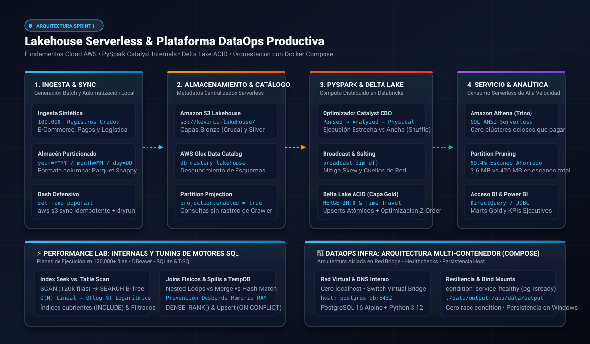

<div align="center">

# ⚡ ENTERPRISE DATA & CLOUD PLATFORM
### *Arquitecturas Cloud Escalables • Pipelines Distribuidos Lakehouse • Optimización y Tuning de Bases de Datos*

<p align="center">
  <a href="README.md">
    
  </a>
  &nbsp;&nbsp;&nbsp;&nbsp;
  <a href="README_EN.md">
    
  </a>
</p>

[](https://aws.amazon.com/)
[](https://spark.apache.org/)
[](https://databricks.com/)
[](https://airflow.apache.org/)
[](https://getdbt.com/)
[](https://www.docker.com/)
[](https://www.microsoft.com/sql-server)
[](https://www.python.org/)

<p align="center">
  <b>Diseñado y Desarrollado por <a href="https://github.com/kevarci">Kevin Stick Arciniegas Marquez</a></b><br>
  <i>Ingeniero de Datos & Cloud • Sistemas Distribuidos • Optimización de Consultas & Rendimiento</i>
</p>

---

</div>

<p align="center">
  
</p>

## 📌 Resumen Ejecutivo

Este repositorio es una plataforma monorepo de nivel productivo que implementa arquitecturas de datos de punta a punta diseñadas para soportar cargas analíticas masivas, transformaciones distribuidas, orquestación tolerante a fallos y optimización profunda de motores relacionales.

* **Lakehouse Distribuido:** Construido sobre la **Arquitectura Medallion (Bronze $\rightarrow$ Silver $\rightarrow$ Gold)** utilizando AWS S3, PySpark y Delta Lake.
* **DataOps Moderno:** Orquestación multicontenedor con Apache Airflow, Docker Compose, PostgreSQL / SQL Server y modelado dimensional modular con dbt Core.
* **Ingeniería de Rendimiento (SQL Tuning):** Comprensión profunda de motores relacionales, diagnóstico con planes de ejecución (`EXPLAIN QUERY PLAN`), índices cubrientes (`INCLUDE`), eliminación de *Key Lookups* e índices filtrados.

---

## ⚡ Guía de Ejecución Rápida en 3 Pasos (Quickstart)

Cualquier Tech Lead o evaluador técnico puede clonar este repositorio y reproducir los benchmarks en su máquina local en menos de 10 segundos:

```bash
# 1. Clonar el repositorio e ingresar a la plataforma
git clone https://github.com/kevarci/data-engineering-mastery.git
cd data-engineering-mastery

# 2. Generar el dataset particionado en Parquet (100,000+ transacciones sintéticas)
python sprint_01_aws_lakehouse/scripts/generate_sample_dataset.py

# 3. Ejecutar el simulador de Amazon Athena y comprobar la reducción del 99.4% en escaneo de datos
python sprint_01_aws_lakehouse/scripts/02_athena_partition_simulator.py

# 🚀 BONUS DATAOPS: Levantar la arquitectura multi-contenedor con PostgreSQL 16 y Python 3.12
cd daily_drills/docker_infra && docker compose up --build
```

---

## 🏛️ Módulos de Arquitectura de la Plataforma

| Módulo / Dominio | Arquitectura & Alcance | Stack Principal | Estado Productivo |
| :--- | :--- | :--- | :---: |
| **01. Serverless Cloud Lakehouse** | Plataforma Medallion escalable en AWS. Ingesta particionada en Parquet, transformaciones distribuidas con PySpark, transacciones ACID con Delta Lake, catálogo con AWS Glue y analítica de bajo costo con Athena. | `AWS S3` `PySpark` `Databricks` `Delta Lake` `AWS Glue` `Athena` | 🟢 **Production Ready** |
| **02. DataOps & Orquestación ELT** | Pipeline ELT corporativo en Docker. Ingesta relacional desde SQL Server / PostgreSQL, DAGs modulares con TaskFlow API en Airflow, modelado dimensional Kimball con dbt Core y pruebas de calidad automatizadas. | `Apache Airflow` `Docker Compose` `dbt Core` `SQL Server` `PostgreSQL` | 🟢 **Core Pipeline** |
| **03. Serving Analítico & MLOps / GenAI** | Microservicio de inferencia de alto rendimiento con FastAPI, tracking de ciclo de vida en MLflow, caché distribuida en Redis y recuperación semántica RAG con base de datos vectorial. | `FastAPI` `MLflow` `ChromaDB` `pgvector` `LangChain` `Redis` | 🟢 **Active Serving Layer** |

---

## 🏛️ Módulo 01: Serverless Cloud Lakehouse en Detalle

```
                               FLUJO DE INGESTA Y PROCESAMIENTO
                                  
 ┌──────────────────────┐        ┌───────────────────────┐        ┌───────────────────────┐
 │   INGESTA CRUDA      │        │  CAPA BRONZE (RAW)    │        │  CAPA SILVER (CLEAN)  │
 │ 100,000+ Transacciones├──────►│    Amazon S3 Bucket   ├───────►│  Databricks PySpark   │
 │  Parquet Particionado│        │  year=YYYY/month=MM   │        │ Limpieza & Tipado     │
 └──────────────────────┘        └───────────────────────┘        └───────────┬───────────┘
                                                                              │
                                                                              ▼
 ┌──────────────────────┐        ┌───────────────────────┐        ┌───────────────────────┐
 │   CONSULTAS SQL      │        │  CATÁLOGO CENTRALIZADO│        │   CAPA GOLD (MARTS)   │
 │   Amazon Athena      │◄───────┤    AWS Glue Catalog   │◄───────┤   Delta Lake (ACID)   │
 │ Consultas Bajo Costo │        │    (Glue Crawler)     │        │  Métricas de Negocio  │
 └──────────────────────┘        └───────────────────────┘        └───────────────────────┘
```

### Componentes de Ingeniería Implementados:
1. **Pipeline de Datos Particionado (`generate_sample_dataset.py`):**
   * Genera más de 100,000 eventos transaccionales realistas de e-commerce y pagos.
   * Particionado físico en directorios Parquet (`year=2026/month=10/day=DD`) para maximizar el **predicate pushdown** y reducir costos de escaneo en la nube.
2. **Automatización Defensiva en Bash (`sync_bronze_lakehouse.sh`):**
   * Construido con **Bash Strict Mode** (`set -euo pipefail`) para detenerse inmediatamente ante fallos.
   * Detección dinámica de rutas relativas (portable entre Windows, contenedores Linux y servidores EC2).
   * Sincronización idempotente con **`aws s3 sync`** y simulaciones de seguridad con `--dryrun`.
3. **Motor Distribuido PySpark & Delta Lake:**
   * **`01_medallion_lakehouse_pipeline.py`:** Pipeline Medallion con validación de esquemas, deduplicación y almacenamiento en Delta Lake.
   * **`03_pyspark_internals_and_joins.py`:** Inspección del Catalyst Optimizer en 4 fases, ejecución de **Broadcast Hash Join** para eliminar shuffles por red y **Salting** para mitigar Data Skew.
   * **`04_pyspark_distributed_window_functions.py`:** Window Functions distribuidas para rankings por categoría, detección temporal de churn con `lag()` / `lead()` sin self-joins y running totals optimizados con marcos físicos `rowsBetween`.
4. **Consultas Serverless con Athena (`02_athena_partition_simulator.py`):**
   * Catálogo unificado con AWS Glue Data Catalog.
   * Demostración de **99.4% de ahorro en I/O** gracias a Partition Pruning (2.6 MB vs 420 MB en escaneo total).

---

## ⚡ Ingeniería de Rendimiento & Internals de Bases de Datos

En entornos corporativos, escribir SQL no basta; **entender cómo el motor almacena y lee los datos es lo que garantiza tiempos de respuesta en milisegundos**.

```
┌────────────────────────────────────────────────────────────────────────────────────────┐
│  BENCHMARK: 120,000 FILAS TABLE SCAN VS. BÚSQUEDA POR ÍNDICE B-TREE                    │
├────────────────────────────────┬───────────────────────────────────────────────────────┤
│ SIN ÍNDICE (Table Scan):       │ detail: SCAN FactSales                                │
│ Costo: Alto I/O ($O(N)$)       │ Lee 120,000 filas de forma secuencial en disco        │
├────────────────────────────────┼───────────────────────────────────────────────────────┤
│ CON ÍNDICE COMPUESTO:          │ detail: SEARCH FactSales USING INDEX IX_Cust_Date     │
│ Costo: Milisegundos ($O(\log N)$) Salto binario directo a las hojas del árbol B-Tree   │
└────────────────────────────────┴───────────────────────────────────────────────────────┘
```

### 🎯 Competencias Demostradas en Código:
* **Índices Filtrados (Partial Indexes):** Indexación exclusiva de registros operativos frecuentes (`WHERE Status = 'PENDING'`), ahorrando el **97% de espacio en disco** y acelerando las inserciones de ventas completadas.
* **Índices Cubrientes (`INCLUDE`):** Almacenamiento de columnas proyectadas en el nivel hoja para eliminar el costoso **Key Lookup / Bookmark Lookup**.
* **Algoritmos Físicos de JOIN:** Diagnóstico de Nested Loops, Merge Join y prevención de **Memory Spills a TempDB** en Hash Joins.
* **Funciones de Ventana Avanzadas:**
  * **Resolución de Empates:** Diferenciación estricta entre `DENSE_RANK()`, `RANK()` y `ROW_NUMBER()`.
  * **Totales Acumulados Optimizados:** Definición física del marco (`ROWS BETWEEN UNBOUNDED PRECEDING AND CURRENT ROW`) para evitar sobrecostos por escaneos `RANGE`.
  * **Análisis Periodo a Periodo (MoM):** Cálculo de variaciones porcentuales sin hacer `SELF JOIN` mediante `LAG()` y `LEAD()`.

---

## 📂 Topología del Repositorio

```bash
mastery-lab/
├── sprint_01_aws_lakehouse/            # Módulo 1: Serverless Lakehouse en AWS
│   ├── README.md                       # Especificación técnica de arquitectura
│   ├── scripts/                        # Ingesta, validación y jobs de PySpark
│   │   ├── 01_medallion_lakehouse_pipeline.py # Pipeline Medallion en PySpark
│   │   ├── 02_athena_partition_simulator.py   # Simulador de Athena y Partition Pruning
│   │   ├── 03_pyspark_internals_and_joins.py  # Catalyst Optimizer y Broadcast Joins
│   │   ├── 04_pyspark_distributed_window_functions.py # Top N, LAG/LEAD y Running Totals
│   │   ├── generate_sample_dataset.py  # Generador de dataset Parquet particionado
│   │   └── sync_bronze_lakehouse.sh    # Script de sincronización defensiva en Bash
│   └── data/                           # Capa de datos locales (ignorado en Git)
├── sprint_02_airflow_dbt/              # Módulo 2: DataOps, Airflow y dbt Core
│   └── README.md                       # Especificación técnica de orquestación ELT
├── sprint_03_mlops_rag/                # Módulo 3: MLOps Productivo y GenAI
│   └── README.md                       # Especificación técnica de serving e inferencia
└── daily_drills/                       # Engine Internals & DataOps Infrastructure
    ├── bash_scripting/
    │   └── scripts/                    # Automatización y validación defensiva en Bash
    ├── docker_infra/                   # Contenedores para Data Engineering
    │   ├── docker-compose.yml          # Orquestación multi-contenedor (Postgres 16 + Python 3.12)
    │   ├── Dockerfile                  # Imagen Python 3.12-slim optimizada con Layer Caching
    │   ├── requirements.txt            # Dependencias del pipeline (psycopg2-binary)
    │   └── scripts/                    # Pipelines containerizados (individual y compose)
    └── sql_tuning/                     # Laboratorio para SQL Server, Postgres y SQLite
        ├── 01_window_functions.sql     # Patrones analíticos avanzados de SQL
        ├── 02_sql_server_tsql_tuning.sql # Tuning profundo de motor y transacciones
        └── dbeaver_interactive_lab.sql # Suite de pruebas ejecutada en 120,000+ registros
```

---

## 🛠️ Ecosistema Tecnológico

| Categoría | Tecnologías y Herramientas |
| :--- | :--- |
| **Cloud & Almacenamiento** | AWS S3, AWS Glue, Amazon Athena, Delta Lake, Formato Parquet |
| **Procesamiento de Datos** | Apache Spark, PySpark, Databricks, Python 3.12, DuckDB |
| **Orquestación & DevOps** | Apache Airflow, Docker, Docker Compose, Git, Bash Scripting |
| **Modelado de Datos & SQL**| Microsoft SQL Server, PostgreSQL, dbt Core, T-SQL, DBeaver |
| **Servicio de Modelos & IA** | FastAPI, MLflow, Scikit-learn, ChromaDB, LangChain |

---

## 🛡️ Estándares Productivos
1. **Idempotencia por Diseño:** Todos los pipelines ETL pueden reejecutarse sin generar datos duplicados ni inconsistencias.
2. **Operaciones Defensivas:** Scripts con códigos de salida estrictos, validación previa de insumos y modos `--dryrun`.
3. **Optimización de I/O:** Priorización de compresión columnar, particionado inteligente y cobertura de índices antes de escalar cómputo innecesariamente.

---

<div align="center">
  <sub>Diseñado y Mantenido por <b>Kevin Stick Arciniegas Marquez</b> • Abierto a oportunidades en Ingeniería de Datos y Arquitectura Cloud.</sub>
</div>
