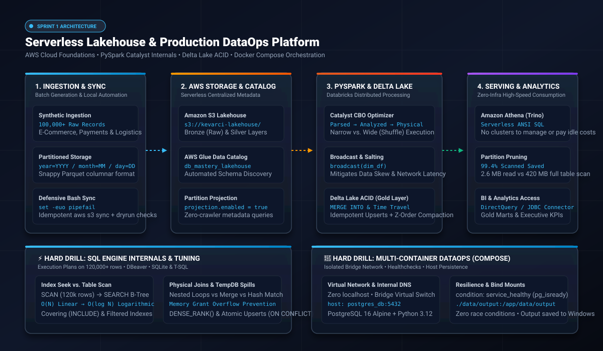

<div align="center">

# ⚡ ENTERPRISE DATA & CLOUD ENGINEERING LAB
### *Scalable Cloud Architectures • Distributed Lakehouse Pipelines • Database Performance Engineering*

<p align="center">
  <a href="README.md">
    
  </a>
  &nbsp;&nbsp;&nbsp;&nbsp;
  <a href="README_EN.md">
    
  </a>
</p>

[](https://aws.amazon.com/)
[](https://spark.apache.org/)
[](https://databricks.com/)
[](https://airflow.apache.org/)
[](https://getdbt.com/)
[](https://www.docker.com/)
[](https://www.microsoft.com/sql-server)
[](https://www.python.org/)

<p align="center">
  <b>Architected by <a href="https://github.com/kevarci">Kevin Stick Arciniegas Marquez</a></b><br>
  <i>Data & Cloud Engineer • Distributed Systems • Query Performance Optimization</i>
</p>

---

</div>

<p align="center">
  
</p>

## 📌 Executive Summary

This repository is a production-grade monorepo containing end-to-end data architectures designed to handle high-throughput analytical workloads, distributed transformations, zero-data-loss orchestration, and deep database performance tuning.

* **Distributed Lakehouse:** Built on the **Medallion Architecture (Bronze $\rightarrow$ Silver $\rightarrow$ Gold)** using AWS S3, PySpark, and Delta Lake.
* **Modern DataOps:** Multi-container orchestration with Apache Airflow, Docker Compose, SQL Server, and modular SQL transformations via dbt Core.
* **Performance Engineering:** Relational engine internals, query execution plan diagnostics (`EXPLAIN ANALYZE`), covering indexes (`INCLUDE`), and partial/filtered indexing.

---

## ⚡ Quickstart: How to Run in 3 Commands

Any Tech Lead or hiring manager can clone this repository and test the benchmarks locally in under 10 seconds:

```bash
# 1. Clone the repository and navigate into the project
git clone https://github.com/kevarci/data-engineering-mastery.git
cd data-engineering-mastery

# 2. Generate partitioned Parquet dataset (100,000+ synthetic transactions)
python sprint_01_aws_lakehouse/scripts/generate_sample_dataset.py

# 3. Run the Amazon Athena simulator and verify 99.4% data scan savings
python sprint_01_aws_lakehouse/scripts/02_athena_partition_simulator.py

# 🚀 BONUS DATAOPS: Launch the multi-container architecture (PostgreSQL 16 + Python 3.12)
cd daily_drills/docker_infra && docker compose up --build
```

---

## 🚀 Engineering Roadmap & Delivery Board

```
┌────────────────────────────────────────────────────────────────────────────────────────┐
│  SPRINT STATUS OVERVIEW                                                                │
│  [■■■■■■■■■■■■■■■■■□□□] 85% Completed Milestone Delivery                               │
└────────────────────────────────────────────────────────────────────────────────────────┘
```

| Phase / Milestone | Architecture & Scope | Core Stack | Status |
| :--- | :--- | :--- | :---: |
| **Sprint 1: Serverless Cloud Lakehouse** | Scalable Medallion Lakehouse on AWS. Partitioned Parquet ingestion, PySpark cleaning, Delta Lake ACID transactions, Glue Data Catalog, and Athena analytics. | `AWS S3` `PySpark` `Databricks` `Delta Lake` `AWS Glue` `Athena` | 🟡 **IN PROGRESS (85% Delivered)** |
| **Sprint 2: DataOps & Orchestration** | Enterprise ELT orchestration in Docker. Relational ingestion from SQL Server, modular DAGs with TaskFlow API, dbt Core star-schema modeling, and automated data contracts. | `Apache Airflow` `Docker Compose` `dbt Core` `SQL Server` `PostgreSQL` | ⚪ Planned |
| **Sprint 3: MLOps & GenAI Serving** | High-performance inference microservice with FastAPI, experiment tracking with MLflow, containerized multi-stage builds, and RAG retrieval via Vector DB. | `FastAPI` `MLflow` `ChromaDB` `pgvector` `LangChain` `Redis` | ⚪ Planned |

---

## 📚 Engineering Study Handbooks

For deep dives into architectural decisions, system design patterns, and technical interview preparation, this repository provides **3 Senior-level Engineering Handbooks**:

| Handbook | Core Domain | Key Concepts Covered | Link |
| :--- | :--- | :--- | :---: |
| 📘 **Handbook 01: Databricks & Lakehouse** | Medallion Architecture & Delta Lake | SparkSession, Distributed Compute, `dropDuplicates`, Delta Log, `OPTIMIZE`, `Z-ORDER`, Time Travel | [View Handbook 01](sprint_01_aws_lakehouse/docs/NOTAS_CLASE_DATABRICKS.md) |
| 📗 **Handbook 02: SQL & T-SQL Performance** | Relational Engine Tuning | `EXPLAIN QUERY PLAN` (Scan vs Seek), Covering Indexes (`INCLUDE`), Filtered Indexes, `CROSS APPLY`, Window Functions (`DENSE_RANK`, `ROWS BETWEEN`, `LAG`) | [View Handbook 02](daily_drills/sql_tuning/docs/CUADERNO_ESTUDIO_SQL_TUNING.md) |
| 📙 **Handbook 03: Infra & DataOps** | Linux Scripting & Cloud Automation | Bash Strict Mode (`set -euo pipefail`), Dynamic path resolution, Defensive assertions, Idempotency with `aws s3 sync` | [View Handbook 03](daily_drills/bash_scripting/docs/CUADERNO_ESTUDIO_BASH_DATAOPS.md) |

---

## 🏛️ Active Architecture: Serverless Lakehouse (Sprint 1)

```
                                  DATA INGESTION & STORAGE FLOW
                                  
 ┌──────────────────────┐        ┌───────────────────────┐        ┌───────────────────────┐
 │   RAW INGESTION      │        │  BRONZE LAYER (RAW)   │        │ SILVER LAYER (CLEAN)  │
 │ 100,000+ Transactions├───────►│    Amazon S3 Bucket   ├───────►│  Databricks PySpark   │
 │ Partitioned Parquet  │        │  year=YYYY/month=MM   │        │ Schema & Deduplication│
 └──────────────────────┘        └───────────────────────┘        └───────────┬───────────┘
                                                                              │
                                                                              ▼
 ┌──────────────────────┐        ┌───────────────────────┐        ┌───────────────────────┐
 │   ANALYTICAL SQL     │        │  CENTRAL DATA CATALOG │        │  GOLD LAYER (MARTS)   │
 │   Amazon Athena      │◄───────┤    AWS Glue Catalog   │◄───────┤   Delta Lake (ACID)   │
 │ Serverless Analytics │        │    (Glue Crawler)     │        │  Aggregated Business  │
 └──────────────────────┘        └───────────────────────┘        └───────────────────────┘
```

### Key Engineering Artifacts in Sprint 1:
1. **Partitioned Data Pipeline (`generate_sample_dataset.py`):**
   * Generates 100,000+ realistic e-commerce and financial events.
   * Physically partitioned into Parquet directories (`year=2026/month=10/day=DD`) for optimal **predicate pushdown** and cloud cost reduction.
2. **Defensive Ingestion Automation (`sync_bronze_lakehouse.sh`):**
   * Engineered with **Bash Strict Mode** (`set -euo pipefail`) to prevent silent failures.
   * Auto-discovers relative paths (cross-platform compatible between Windows, Linux containers, and EC2).
   * Executes idempotent **`aws s3 sync`** with safe `--dryrun` pre-flight checks.

---

## ⚡ Performance Engineering & Database Internals (`daily_drills/`)

In enterprise environments, writing SQL is not enough; **understanding how the database storage engine executes queries is what guarantees sub-second SLAs**.

```
┌────────────────────────────────────────────────────────────────────────────────────────┐
│  BENCHMARK: 120,000 ROWS TABLE SCAN VS. B-TREE SEARCH                                  │
├────────────────────────────────┬───────────────────────────────────────────────────────┤
│ WITHOUT INDEX (Table Scan):    │ detail: SCAN FactSales                                │
│ Cost: High I/O ($O(N)$)       │ Scans 120,000 rows sequentially from disk             │
├────────────────────────────────┼───────────────────────────────────────────────────────┤
│ WITH COMPOSITE INDEX:          │ detail: SEARCH FactSales USING INDEX IX_Cust_Date     │
│ Cost: Sub-millisecond ($O(\log N)$) B-Tree binary traversal directly to target leaves  │
└────────────────────────────────┴───────────────────────────────────────────────────────┘
```

### 🎯 Hard Skills Demonstrated:
* **Filtered / Partial Indexes:** Indexing only active operational records (`WHERE Status = 'PENDING'`), eliminating **97% of storage footprint** and shielding insert throughput.
* **Covering Indexes (`INCLUDE`):** Storing projected attributes in leaf pages to eliminate expensive **Key Lookups / Bookmark Lookups**.
* **Advanced Window Functions:**
  * **Tie Resolution:** Precise application of `DENSE_RANK()` vs `RANK()` vs `ROW_NUMBER()`.
  * **Optimized Running Totals:** Explicit physical frame definition (`ROWS BETWEEN UNBOUNDED PRECEDING AND CURRENT ROW`) to bypass slow `RANGE` spooling.
  * **Period-over-Period (MoM):** Zero-join sequential delta calculations with `LAG()` / `LEAD()`.

---

## 📂 Repository Topology

```bash
mastery-lab/
├── sprint_01_aws_lakehouse/            # SPRINT 1: Serverless Lakehouse on AWS
│   ├── README.md                       # Architecture diagram and step-by-step setup
│   ├── docs/                           # Engineering Handbooks
│   │   ├── NOTAS_CLASE_DATABRICKS.md   # PySpark, Distributed Compute & Delta Lake
│   │   ├── CUADERNO_ESTUDIO_AWS_GLUE_ATHENA.md # S3, Glue Data Catalog & Athena
│   │   └── CUADERNO_ESTUDIO_PYSPARK_INTERNALS.md # Catalyst, Shuffle, Joins & Salting
│   ├── scripts/                        # Ingestion, validation & PySpark jobs
│   │   ├── 01_medallion_lakehouse_pipeline.py # Local Databricks backup script
│   │   ├── 02_athena_partition_simulator.py   # Athena & Partition Pruning Simulator
│   │   ├── 03_pyspark_internals_and_joins.py  # Catalyst & Broadcast Joins Lab
│   │   ├── generate_sample_dataset.py  # Partitioned Parquet dataset generator
│   │   └── sync_bronze_lakehouse.sh    # Production Bash automation script
│   └── data/                           # Partitioned raw data layer (local dev)
├── sprint_02_airflow_dbt/              # SPRINT 2: DataOps, Airflow & dbt Core
│   ├── README.md                       # Containerized orchestration guide
│   └── docs/                           # DataOps Handbook (Upcoming)
├── sprint_03_mlops_rag/                # SPRINT 3: Production MLOps & GenAI
│   ├── README.md                       # FastAPI, Model Registry & Vector Database
│   └── docs/                           # MLOps Handbook (Upcoming)
└── daily_drills/                       # Technical Drills & Performance Engineering
    ├── bash_scripting/
    │   └── docs/                       # Bash & DataOps Handbook
    ├── docker_infra/                   # Containers for Data Engineering
    │   ├── docs/                       # Docker & DataOps Handbook
    │   ├── docker-compose.yml          # Multi-container orchestration (Postgres 16 + Python 3.12)
    │   ├── Dockerfile                  # Production Python 3.12-slim image
    │   ├── requirements.txt            # Pipeline dependencies (psycopg2-binary)
    │   └── scripts/                    # Containerized data pipeline runners
    └── sql_tuning/                     # SQL Server, PostgreSQL & SQLite Benchmarks
        ├── docs/                       # SQL Performance Tuning Handbook
        ├── 01_window_functions.sql     # Live-coding interview patterns
        ├── 02_sql_server_tsql_tuning.sql # Deep engine tuning & transaction handling
        └── dbeaver_interactive_lab.sql # Benchmark test suite (120,000+ records)
```

---

## 🛠️ Technology Ecosystem

| Category | Technologies & Tools |
| :--- | :--- |
| **Cloud & Storage** | AWS S3, AWS Glue, Amazon Athena, Delta Lake, Parquet Format |
| **Data Processing** | Apache Spark, PySpark, Databricks, Python 3.12, DuckDB |
| **Orchestration & DevOps**| Apache Airflow, Docker, Docker Compose, Git, Bash Scripting |
| **Data Modeling & SQL** | Microsoft SQL Server, PostgreSQL, dbt Core, T-SQL, DBeaver |
| **Serving & AI** | FastAPI, MLflow, Scikit-learn, ChromaDB, LangChain |

---

## 🛡️ Production Standards
1. **Idempotency by Design:** All ETL pipelines can run repeatedly without producing duplicated data or side effects.
2. **Defensive Operations:** Scripts employ strict exit codes, input validation, and dry-run execution modes.
3. **Optimized I/O:** Partition pruning, columnar compression, and index coverage are prioritized over raw compute scale.

---

<div align="center">
  <sub>Maintained by <b>Kevin Stick Arciniegas Marquez</b> • Open for Data Engineering & Cloud Architecture opportunities.</sub>
</div>
