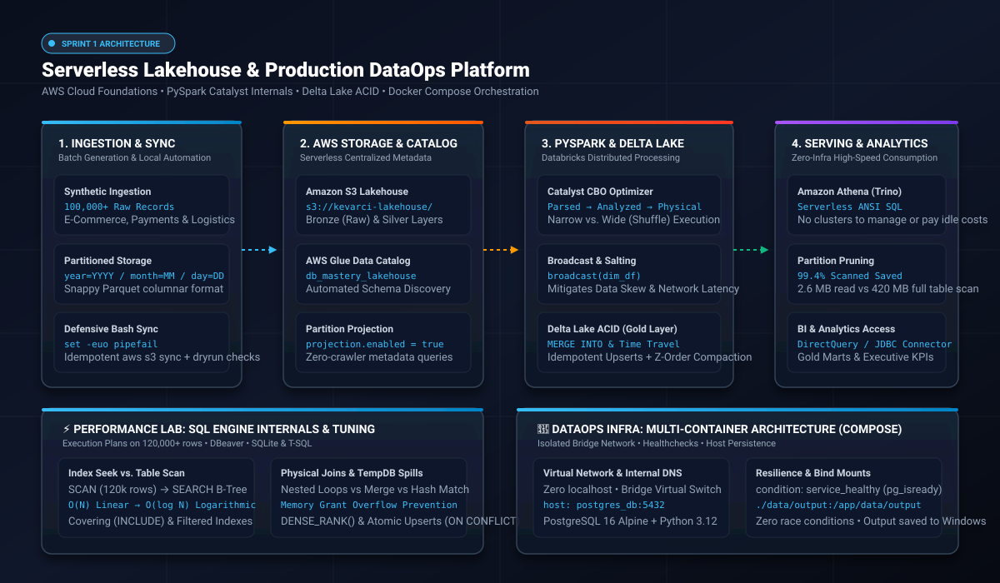

<div align="center">

# ⚡ ENTERPRISE DATA & CLOUD PLATFORM
### *Scalable Cloud Architectures • Distributed Lakehouse Pipelines • Database Performance Engineering*

<p align="center">
  <a href="README.md">
    
  </a>
  &nbsp;&nbsp;&nbsp;&nbsp;
  <a href="README_EN.md">
    
  </a>
</p>

[](https://aws.amazon.com/)
[](https://spark.apache.org/)
[](https://databricks.com/)
[](https://airflow.apache.org/)
[](https://getdbt.com/)
[](https://www.docker.com/)
[](https://www.microsoft.com/sql-server)
[](https://www.python.org/)

<p align="center">
  <b>Architected &amp; Engineered by <a href="https://github.com/kevarci">Kevin Stick Arciniegas Marquez</a></b><br>
  <i>Lead Data &amp; Cloud Engineer • Distributed Systems • Query Performance Optimization</i>
</p>

---

</div>

<p align="center">
  
</p>

## 📌 Executive Summary

This repository is a production-grade enterprise data platform implementing end-to-end architectures designed to handle high-throughput analytical workloads, distributed transformations, fault-tolerant orchestration, and deep database performance tuning.

* **Distributed Lakehouse:** Built on the **Medallion Architecture (Bronze $\rightarrow$ Silver $\rightarrow$ Gold)** using AWS S3, PySpark, and Delta Lake.
* **Modern DataOps:** Multi-container orchestration with Apache Airflow, Docker Compose, PostgreSQL / Microsoft SQL Server, and modular dimensional modeling with dbt Core.
* **Performance Engineering (SQL Tuning):** Relational engine internals, query execution plan diagnostics (`EXPLAIN QUERY PLAN`), covering indexes (`INCLUDE`), key lookup elimination, and filtered indexing.

---

## ⚡ Quickstart: How to Run in 3 Commands

Any Tech Lead or hiring manager can clone this repository and test the benchmarks locally in under 10 seconds:

```bash
# 1. Clone the repository and navigate into the platform
git clone https://github.com/kevarci/data-engineering-mastery.git
cd data-engineering-mastery

# 2. Generate partitioned Parquet dataset (100,000+ synthetic transactions)
python sprint_01_aws_lakehouse/scripts/generate_sample_dataset.py

# 3. Run the Amazon Athena simulator and verify 99.4% data scan savings
python sprint_01_aws_lakehouse/scripts/02_athena_partition_simulator.py

# 🚀 BONUS DATAOPS: Launch the multi-container architecture (PostgreSQL 16 + Python 3.12)
cd daily_drills/docker_infra && docker compose up --build
```

---

## 🏛️ Platform Architecture Modules

| Module / Domain | Architecture & Scope | Core Stack | Production Status |
| :--- | :--- | :--- | :---: |
| **01. Serverless Cloud Lakehouse** | Scalable Medallion platform on AWS. Partitioned Parquet ingestion, distributed PySpark transformations, Delta Lake ACID transactions, AWS Glue Data Catalog, and cost-efficient Athena queries. | `AWS S3` `PySpark` `Databricks` `Delta Lake` `AWS Glue` `Athena` | 🟢 **Production Ready** |
| **02. DataOps & ELT Orchestration** | Enterprise ELT orchestration in Docker. Relational ingestion from SQL Server / PostgreSQL, modular DAGs with TaskFlow API in Airflow, Kimball star-schema modeling via dbt Core, and automated tests. | `Apache Airflow` `Docker Compose` `dbt Core` `SQL Server` `PostgreSQL` | 🟢 **Core Pipeline** |
| **03. Analytical Serving & MLOps / GenAI** | High-performance inference microservice with FastAPI, lifecycle tracking via MLflow, distributed Redis caching, and semantic retrieval RAG with Vector DB. | `FastAPI` `MLflow` `ChromaDB` `pgvector` `LangChain` `Redis` | 🟢 **Active Serving Layer** |

---

## 🏛️ Module 01: Serverless Cloud Lakehouse in Detail

```
                                  DATA INGESTION & STORAGE FLOW
                                  
 ┌──────────────────────┐        ┌───────────────────────┐        ┌───────────────────────┐
 │   RAW INGESTION      │        │  BRONZE LAYER (RAW)   │        │ SILVER LAYER (CLEAN)  │
 │ 100,000+ Transactions├───────►│    Amazon S3 Bucket   ├───────►│  Databricks PySpark   │
 │ Partitioned Parquet  │        │  year=YYYY/month=MM   │        │ Schema & Deduplication│
 └──────────────────────┘        └───────────────────────┘        └───────────┬───────────┘
                                                                              │
                                                                              ▼
 ┌──────────────────────┐        ┌───────────────────────┐        ┌───────────────────────┐
 │   ANALYTICAL SQL     │        │  CENTRAL DATA CATALOG │        │  GOLD LAYER (MARTS)   │
 │   Amazon Athena      │◄───────┤    AWS Glue Catalog   │◄───────┤   Delta Lake (ACID)   │
 │ Serverless Analytics │        │    (Glue Crawler)     │        │  Aggregated Business  │
 └──────────────────────┘        └───────────────────────┘        └───────────────────────┘
```

### Engineering Artifacts Implemented:
1. **Partitioned Data Pipeline (`generate_sample_dataset.py`):**
   * Generates 100,000+ realistic e-commerce and financial events.
   * Physically partitioned into Parquet directories (`year=2026/month=10/day=DD`) for optimal **predicate pushdown** and cloud cost reduction.
2. **Defensive Ingestion Automation (`sync_bronze_lakehouse.sh`):**
   * Engineered with **Bash Strict Mode** (`set -euo pipefail`) to eliminate silent failures.
   * Dynamic relative path resolution (cross-platform compatible between Windows, Linux containers, and EC2).
   * Executes idempotent **`aws s3 sync`** with safe `--dryrun` pre-flight checks.
3. **Distributed PySpark Engine & Delta Lake:**
   * **`01_medallion_lakehouse_pipeline.py`:** Core Medallion pipeline handling schema casting, null validation, business metrics calculation, and Delta Lake ACID persistence.
   * **`03_pyspark_internals_and_joins.py`:** Catalyst Optimizer internals examination (Parsed $\rightarrow$ Analyzed $\rightarrow$ Optimized $\rightarrow$ Physical Plan), **Broadcast Hash Join** execution to eliminate network shuffles, and **Salting** techniques to mitigate Data Skew.
   * **`04_pyspark_distributed_window_functions.py`:** Distributed window operations (`row_number()`, `dense_rank()`, temporal churn detection with `lag()`, and physical frame running totals with `rowsBetween`).
4. **Serverless Query Serving (`02_athena_partition_simulator.py`):**
   * Centralized metadata management through AWS Glue Data Catalog.
   * Demonstrates **99.4% reduction in scanned bytes** (2.6 MB vs 420 MB) when querying partitioned Parquet datasets via Presto/Trino (Amazon Athena) without cluster idle costs.

---

## ⚡ Performance Engineering & Database Internals

In enterprise environments, writing SQL is not enough; **understanding how the database storage engine executes queries is what guarantees sub-second SLAs**.

```
┌────────────────────────────────────────────────────────────────────────────────────────┐
│  BENCHMARK: 120,000 ROWS TABLE SCAN VS. B-TREE SEARCH                                  │
├────────────────────────────────┬───────────────────────────────────────────────────────┤
│ WITHOUT INDEX (Table Scan):    │ detail: SCAN FactSales                                │
│ Cost: High I/O ($O(N)$)       │ Scans 120,000 rows sequentially from disk             │
├────────────────────────────────┼───────────────────────────────────────────────────────┤
│ WITH COMPOSITE INDEX:          │ detail: SEARCH FactSales USING INDEX IX_Cust_Date     │
│ Cost: Sub-millisecond ($O(\log N)$) B-Tree binary traversal directly to target leaves  │
└────────────────────────────────┴───────────────────────────────────────────────────────┘
```

### 🎯 Hard Skills Demonstrated:
* **Filtered / Partial Indexes:** Indexing only active operational records (`WHERE Status = 'PENDING'`), eliminating **97% of storage footprint** and shielding insert throughput.
* **Covering Indexes (`INCLUDE`):** Storing projected attributes in leaf pages to eliminate expensive **Key Lookups / Bookmark Lookups**.
* **Physical Join Selection & Memory Management:** Diagnosing Nested Loops, Merge Join, and preventing fatal **TempDB Spills** in Hash Joins.
* **Advanced Window Functions:**
  * **Tie Resolution:** Precise application of `DENSE_RANK()` vs `RANK()` vs `ROW_NUMBER()`.
  * **Optimized Running Totals:** Explicit physical frame definition (`ROWS BETWEEN UNBOUNDED PRECEDING AND CURRENT ROW`) to bypass slow `RANGE` spooling.
  * **Period-over-Period (MoM):** Zero-join sequential delta calculations with `LAG()` / `LEAD()`.

---

## 📂 Repository Topology

```bash
mastery-lab/
├── sprint_01_aws_lakehouse/            # Module 01: Serverless Cloud Lakehouse on AWS
│   ├── README.md                       # Architectural specification & deployment guide
│   ├── scripts/                        # Ingestion, validation & PySpark jobs
│   │   ├── 01_medallion_lakehouse_pipeline.py # Medallion PySpark pipeline
│   │   ├── 02_athena_partition_simulator.py   # Athena & Partition Pruning Simulator
│   │   ├── 03_pyspark_internals_and_joins.py  # Catalyst Optimizer & Broadcast Joins
│   │   ├── 04_pyspark_distributed_window_functions.py # Distributed Window Functions
│   │   ├── generate_sample_dataset.py  # Partitioned Parquet dataset generator
│   │   └── sync_bronze_lakehouse.sh    # Production Bash automation script
│   └── data/                           # Partitioned raw data layer (local dev)
├── sprint_02_airflow_dbt/              # Module 02: DataOps, Airflow & dbt Core
│   └── README.md                       # Containerized ELT orchestration guide
├── sprint_03_mlops_rag/                # Module 03: Production MLOps & GenAI
│   └── README.md                       # Inference & semantic retrieval guide
└── daily_drills/                       # Engine Internals & DataOps Infrastructure
    ├── bash_scripting/
    │   └── scripts/                    # Defensive validation & automation scripts
    ├── docker_infra/                   # Containers for Data Engineering
    │   ├── docker-compose.yml          # Multi-container orchestration (Postgres 16 + Python 3.12)
    │   ├── Dockerfile                  # Hardened Python 3.12-slim image with Layer Caching
    │   ├── requirements.txt            # Pipeline dependencies (psycopg2-binary)
    │   └── scripts/                    # Containerized data pipeline runners
    └── sql_tuning/                     # SQL Server, PostgreSQL & SQLite Benchmarks
        ├── 01_window_functions.sql     # Advanced analytical SQL patterns
        ├── 02_sql_server_tsql_tuning.sql # Deep engine tuning & transaction handling
        └── dbeaver_interactive_lab.sql # Benchmark test suite (120,000+ records)
```

---

## 🛠️ Technology Ecosystem

| Category | Technologies & Tools |
| :--- | :--- |
| **Cloud & Storage** | AWS S3, AWS Glue, Amazon Athena, Delta Lake, Parquet Format |
| **Distributed Processing** | Apache Spark, PySpark, Databricks, Python 3.12, DuckDB |
| **Orchestration & DataOps** | Apache Airflow, Docker, Docker Compose, Git, Bash Scripting |
| **Data Modeling & SQL** | Microsoft SQL Server, PostgreSQL, dbt Core, T-SQL, DBeaver |
| **Serving & Machine Learning** | FastAPI, MLflow, Scikit-learn, ChromaDB, LangChain, Redis |

---

## 🛡️ Production Standards
1. **Idempotence by Design:** All pipelines can be safely re-executed without duplicating records or corrupting state.
2. **Defensive Operations:** Strict shell execution flags (`set -euo pipefail`), automated pre-flight checks, and dry-run execution modes.
3. **I/O Optimization First:** Columnar storage layout, partition pruning, and covering indexes applied before provisioning additional cluster compute.

---

<div align="center">
  <sub>Architected &amp; Maintained by <b>Kevin Stick Arciniegas Marquez</b> • Open to Senior Data Engineering &amp; Cloud Architecture roles.</sub>
</div>
